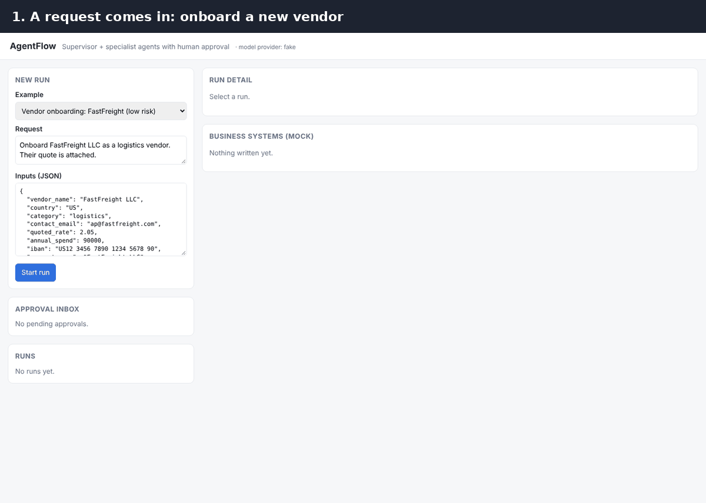
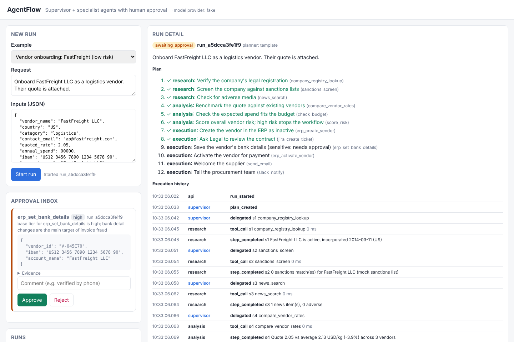
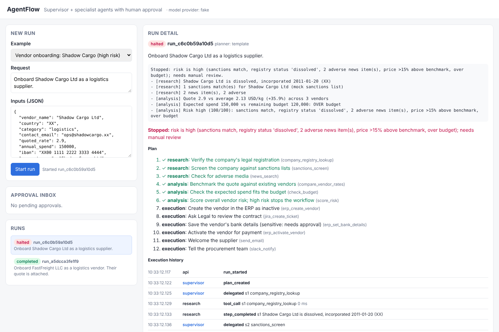
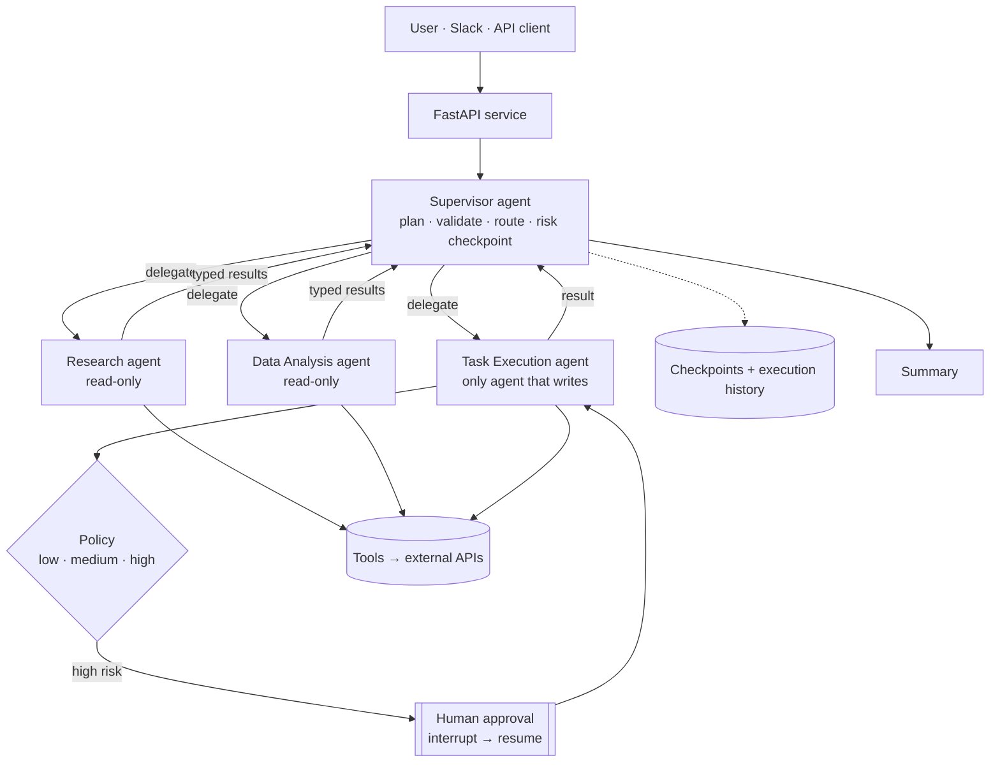

<div align="center">

# AgentFlow

**Multi-agent workflow automation that knows when to ask a human.**

A supervisor agent plans cross-department business workflows, delegates them to specialist agents for research, data analysis and task execution, calls real APIs, **pauses for human approval on sensitive actions**, and keeps a full audit trail of every step.

[](https://github.com/madhavimahankali-hash/agentflow/actions/workflows/ci.yml)


[](LICENSE)



</div>

---

## The problem

Teams lose hours every week on work that crosses departments and applications: look something up, check it against data, update three systems, get a sign-off. That work is too varied for RPA scripts, which break when anything changes. It's also too risky for a fully autonomous AI, which could act on a bad decision with nobody checking. So it stays manual.

**AgentFlow sits in the middle.** Agents do the reading, checking and routine updates. Rules decide which actions a person must approve. Every step is recorded.

## What happens in the demo

| | Vendor onboarding: **FastFreight LLC** | Vendor onboarding: **Shadow Cargo Ltd** |
| --- | --- | --- |
| Research | Registered, no sanctions, no adverse news | Dissolved, **sanctions match**, 2 adverse news items |
| Analysis | Quote 3.9% below benchmark, within budget, risk **low (0/100)** | Quote 35.9% above benchmark, over budget, risk **high (100/100)** |
| Execution | Creates vendor (inactive) + Legal ticket automatically | **Never reached**: supervisor halts the run |
| Human approval | **Pauses** before saving bank details; resumes on approval | Not needed: nothing was changed |
| Outcome | Vendor active, supplier emailed, team notified on Slack | Stopped, with every risk reason listed for manual review |

| Run paused for approval | High-risk run stopped before execution |
| --- | --- |
|  |  |

## Highlights

| | What it means | Where |
| --- | --- | --- |
| **Supervisor + specialists** | One agent plans and routes; Research, Data Analysis and Task Execution agents each do one job | [`graph.py`](app/graph.py) |
| **Human-in-the-loop by policy** | Rules on the actual arguments (bank details, payment thresholds, external email) decide approvals, never the model | [`policy.py`](app/policy.py) |
| **Durable pause and resume** | LangGraph `interrupt()` + checkpoints: an approval can arrive hours later, even after a restart | [`runner.py`](app/runner.py) |
| **Prompt-injection containment** | Agents that read untrusted content have no write tools; only the Execution agent can change systems | [ADR 0003](docs/adr/0003-read-write-separation.md) |
| **Validated LLM plans** | Plans are checked: tools exist, belong to the right agent, reads before writes. Invalid plans fall back to a safe template | [`supervisor.py`](app/agents/supervisor.py) |
| **Approvers can edit, not just approve** | A wrong IBAN can be corrected in the approval; edits are re-validated | [`api.py`](app/api.py) |
| **Idempotent writes** | `run_id:step_id` keys: a retry never creates the vendor twice | [`graph.py`](app/graph.py) |
| **Full execution history** | Every plan, delegation, tool call (with latency), approval and decision is logged | [`history.py`](app/history.py) |
| **Evaluation suite** | Measures task success, routing accuracy and approval precision/recall, in CI on every push | [`eval/`](eval/) |
| **Runs anywhere** | Offline mode needs no AWS; Bedrock and AgentCore switch on with configuration | [ADR 0005](docs/adr/0005-offline-first-llm.md) |

## Architecture



**Read more:** [Architecture deep dive](docs/ARCHITECTURE.md) (state model, sequence diagram, security model, failure modes) · [Architecture decision records](docs/adr/)

## Results

All numbers come from this repo and are reproduced by CI on every push.

| Check | Result |
| --- | --- |
| Tests (unit, end-to-end, API, restart, LLM code paths) | **24 passed** |
| Code coverage | **91%** |
| Eval: task success | **5/5** |
| Eval: routing accuracy (exact tool sequence) | **5/5** |
| Eval: approval precision / recall | **100% / 100%** |

These scores are for **offline mode**, where planning uses workflow templates. The suite also includes a **prompt-injection case** (the request claims approval was already granted; the policy still requires it) and **free-text cases** that only run against Bedrock, where the model must extract every input from a plain sentence.

## Quick start

No AWS account needed.

```bash
git clone https://github.com/madhavimahankali-hash/agentflow.git
cd agentflow
python -m venv .venv
source .venv/bin/activate            # Windows PowerShell: .venv\Scripts\Activate.ps1
pip install -r requirements.txt -r requirements-dev.txt
cp .env.example .env                 # Windows: copy .env.example .env

uvicorn app.api:app --reload         # open http://localhost:8000
pytest                               # 24 tests
python -m eval.run_eval              # evaluation report
```

Or with Docker: `docker compose up --build`, then open http://localhost:8000.

### Try it
1. **FastFreight (low risk)** → **Start run**. Watch the plan tick through research and analysis; the run pauses at *Save bank details*.
2. Check **Business systems**: the vendor exists but is `inactive`, with no IBAN.
3. Add a comment and click **Approve**. The run resumes, activates the vendor, emails the supplier and posts to Slack.
4. **Shadow Cargo (high risk)** → **Start run**. It stops before any execution step.
5. **Weekly pipeline report**: the same agents run a different workflow.

## Using Amazon Bedrock

1. In the AWS console, open **Bedrock → Model access** and enable a Claude model (or another model with tool use).
2. Configure AWS credentials (`aws configure`, or `aws sso login` + `AWS_PROFILE` in `.env`) with `bedrock:InvokeModel` permission.
3. In `.env`, set `LLM_PROVIDER=bedrock` and the `SUPERVISOR_MODEL_ID` / `WORKER_MODEL_ID` shown in your console.
4. Check everything with one command, then run the evaluation against the real models:

```bash
python -m scripts.check_bedrock                       # credentials, model access, tool use
python -m eval.run_eval --provider bedrock --save     # writes eval/results/bedrock-<timestamp>.md
```

With Bedrock on:
- the **supervisor** writes the plan itself and extracts inputs from free text (try *"Share how the pipeline moved in 2026-W45 with sales"* with empty inputs)
- **Research and Analysis** run a tool-calling loop over their own tools
- the **summary** is written by the model
- if the model's plan breaks a rule, the validation error is sent back and it gets **one chance to self-correct** before the safe template is used
- every model call is logged with its **purpose, tokens and latency**, visible in the console and in the eval report

## Deploying to Bedrock AgentCore Runtime

[`agentcore_app.py`](agentcore_app.py) wraps the same runner in a `BedrockAgentCoreApp` entrypoint:

```bash
pip install bedrock-agentcore bedrock-agentcore-starter-toolkit
agentcore configure --entrypoint agentcore_app.py
agentcore launch
agentcore invoke '{"action":"start","request":"Send the weekly pipeline report","inputs":{"week":"2026-W45"}}'
```

For multi-session production use, move checkpoints and history from SQLite to a shared store (DynamoDB, or Aurora Postgres with `langgraph-checkpoint-postgres`).

## API

| Method | Path | Purpose |
| --- | --- | --- |
| `POST` | `/runs` | Start a run `{request, inputs}` → `202 {run_id}` |
| `GET` | `/runs`, `/runs/{id}` | Status, plan, results, pending approval |
| `GET` | `/runs/{id}/history` | Full execution history: events + approvals |
| `GET` | `/approvals?status=pending` | Approval inbox (expires stale requests) |
| `POST` | `/approvals/{id}` | `{decision, approver, comment, edited_args?}` → resumes the run |
| `GET` | `/tools` · `/systems` · `/graph` | Tool catalog · mock system state · live Mermaid graph |

Interactive docs at `/docs` (Swagger UI).

## Integrations

| Integration | Default | Real mode |
| --- | --- | --- |
| Sanctions screening | Mock watch list | [OpenSanctions](https://www.opensanctions.org/api/) API: set `OPENSANCTIONS_API_KEY` |
| Slack | Logged to mock table | Incoming webhook: set `SLACK_WEBHOOK_URL` |
| ERP · Jira · email · company registry · data warehouse | SQLite-backed mocks with real state changes | Replace the call inside the tool in [`app/tools/`](app/tools/); agents don't change |

## Project structure

```
app/
  api.py            FastAPI endpoints + demo console (static/index.html)
  graph.py          LangGraph: supervisor, agents, approval gate, finalize
  runner.py         start · resume · inspect runs (shared by API and AgentCore)
  policy.py         risk tiers and approval rules
  history.py        execution history, approvals, idempotency
  llm.py            Bedrock model factory (offline fallback)
  agents/           supervisor planner · research/analysis agents · workflow templates
  tools/            tool registry · research · analysis · execution · mock systems
agentcore_app.py    Bedrock AgentCore Runtime entrypoint
eval/               evaluation cases + harness
tests/              24 tests
scripts/            Bedrock pre-flight check
docs/               architecture, decision records, demo media
.github/workflows/  CI: lint · tests · coverage · eval
```

## Roadmap

- [ ] Run the evaluation suite against Bedrock and publish the scores
- [ ] Expose tools through **AgentCore Gateway** (MCP), with credentials in **AgentCore Identity**
- [ ] **AgentCore Memory** for learned preferences (e.g. "Legal always wants the PO number")
- [ ] **Bedrock Guardrails** on model input and output
- [ ] Re-plan after a rejected approval instead of stopping
- [ ] Run independent research steps in parallel
- [ ] Slack interactive approval buttons
- [ ] Postgres checkpointer for multi-replica deployments

## Tech stack

**Python 3.11+** · **LangGraph** (state graph, checkpoints, `interrupt`) · **Amazon Bedrock** (Converse API via `langchain-aws`) · **Amazon Bedrock AgentCore Runtime** · **FastAPI** · **Pydantic v2** · **SQLite** · **pytest** · **ruff** · **GitHub Actions** · **Docker**

## Author

Built by **Madhavi Mahankali** ([@madhavimahankali-hash](https://github.com/madhavimahankali-hash)). Licensed under [MIT](LICENSE).
