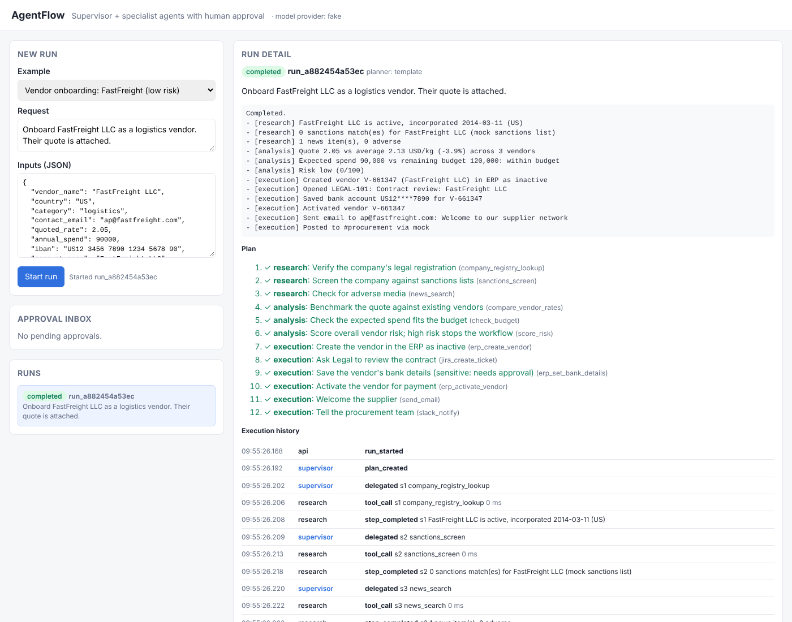
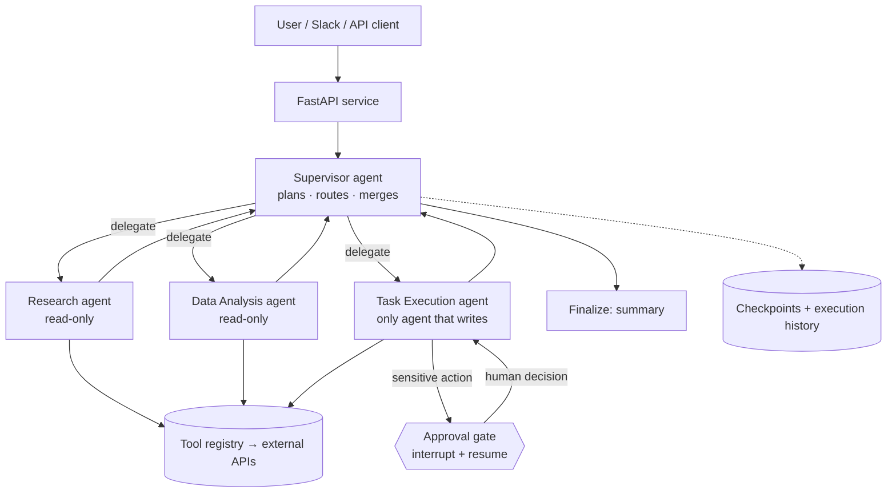

# AgentFlow: Multi-Agent Enterprise Workflow Automation

A supervisor agent plans business workflows and delegates them to specialist agents for **research**, **data analysis** and **task execution**. The agents call external APIs, sensitive actions **pause for human approval**, and every step is written to an **execution history**.

**Stack:** Python · LangGraph · Amazon Bedrock · Amazon Bedrock AgentCore · FastAPI



---

## 1. Quick start (no AWS needed)

```bash
python -m venv .venv && source .venv/bin/activate     # Windows: .venv\Scripts\activate
pip install -r requirements.txt
cp .env.example .env                                  # LLM_PROVIDER=fake runs fully offline

uvicorn app.api:app --reload                          # open http://localhost:8000
pytest -q                                             # 23 tests
python -m eval.run_eval                               # evaluation report
```

### Demo script (3 minutes)
1. Pick **Vendor onboarding: FastFreight (low risk)** and click **Start run**.
2. Watch the plan run: research → analysis → execution. The run then **pauses** at *Save bank details*, and a card appears in the **Approval inbox** with the reason and the evidence.
3. Check the **Business systems** panel: the vendor exists but is `inactive`, with no IBAN.
4. Click **Approve**. The run resumes from its checkpoint, saves the bank details, activates the vendor, emails the supplier and posts to Slack.
5. Run **Shadow Cargo (high risk)**. The supervisor stops it **before** any execution step because of a sanctions match and adverse news.
6. Run **Weekly pipeline report**. The same agents run a different workflow, which shows they're reusable.

---

## 2. Architecture



LangGraph graph (generated by `GET /graph`):

```
START → supervisor → {research | analysis | execution | finalize}
research, analysis → supervisor
execution → {approval | supervisor}
approval  → execution   (pauses with interrupt() until a human decides)
finalize  → END
```

### How each requirement is met

| Requirement | Where in the code |
| --- | --- |
| Supervisor agent | `app/agents/supervisor.py` (planning and validation), `supervisor` node in `app/graph.py` (routing, risk checkpoint) |
| Specialised agents | `app/agents/workers.py` (research, analysis), `execution` node in `app/graph.py` |
| Agents communicate and delegate | Typed shared state (`RunState`): every hand-off goes through the supervisor; `{{key}}` references pass results between steps |
| External APIs | `app/tools/`: OpenSanctions API (real, with a key) and Slack webhook (real, with a URL); mock ERP, Jira, email, registry and data warehouse |
| Human approval | `app/policy.py` (rules, never the LLM), `approval` node using LangGraph `interrupt`, `POST /approvals/{id}` |
| Execution history | `app/history.py`: runs, events (with latency), approvals, idempotency keys; `GET /runs/{id}/history` |

---

## 3. Key design decisions

1. **Hub-and-spoke supervisor, not peer-to-peer.** One place owns the plan, which keeps routing predictable and auditable.
2. **Deterministic skeleton, intelligent steps.** LangGraph fixes the allowed paths. The LLM plans and reasons inside them. LLM plans are **validated**: each tool must exist, belong to the step's agent, and reads must come before writes. If a plan is invalid, the supervisor falls back to a known workflow template.
3. **Separation of duties.** Only the Execution agent has write tools. Research and Analysis can't change anything, so prompt injection in a web page or document can't reach a write action.
4. **Policy-driven approvals.** `policy.evaluate()` assigns low / medium / high from rules: amount thresholds, external recipients, bank details. A model can be talked out of asking for approval; a rule can't.
5. **Durable pause and resume.** State is checkpointed after every node (SQLite saver locally). Approval can come hours later, even after a restart (`test_run_survives_restart`).
6. **Idempotent writes.** Each write is keyed `run_id:step_id`, so a replay never creates the vendor twice.
7. **Input validation before every API call.** Each tool has a Pydantic args model (IBAN length, email format, positive amounts).
8. **Retries only for transient errors.** Network errors are retried with backoff. Bad input fails fast.
9. **Offline mode for every LLM call.** The project runs, demos and tests without AWS. Bedrock is switched on by one environment variable.

---

## 4. Switching on Amazon Bedrock

1. In the AWS console, open **Amazon Bedrock → Model access** and enable an Anthropic Claude model (or another model with tool use).
2. Configure credentials locally (`aws configure`, or SSO), with permission for `bedrock:InvokeModel` / `bedrock:Converse`.
3. In `.env`:
   ```
   LLM_PROVIDER=bedrock
   AWS_REGION=us-east-1
   SUPERVISOR_MODEL_ID=<model or inference-profile id from your console>
   WORKER_MODEL_ID=<a cheaper/faster model id>
   ```
   The default IDs in `.env.example` are examples. Use the exact IDs your account shows.
4. Restart the server. Now:
   - The **supervisor** writes the plan with structured output and **extracts inputs from free text**. Try *"Can you share how the pipeline moved in 2026-W45 with sales?"* with empty inputs.
   - The **research / analysis agents** run a tool-calling loop over their own tools and write an assessment note.
   - The **final summary** is written by the model.
5. Run `LLM_PROVIDER=bedrock python -m eval.run_eval` and compare the metrics with offline mode.

## 5. Deploying to Amazon Bedrock AgentCore Runtime

`agentcore_app.py` wraps the same `Runner` in a `BedrockAgentCoreApp` entrypoint:

```bash
pip install bedrock-agentcore bedrock-agentcore-starter-toolkit
agentcore configure --entrypoint agentcore_app.py
agentcore launch
agentcore invoke '{"action":"start","request":"Send the weekly pipeline report","inputs":{"week":"2026-W45"}}'
agentcore invoke '{"action":"decide","approval_id":"<id>","decision":"approve","approver":"cfo@example.com"}'
```

Check the current AgentCore CLI docs before deploying, because the toolkit is new and its commands may change.

**Production notes:** move checkpoints and history from SQLite to a shared store (DynamoDB, or Aurora Postgres with `langgraph-checkpoint-postgres`). That way a decision can resume a run from any session.

## 6. Real vs mocked integrations

| Integration | Default | Real mode |
| --- | --- | --- |
| Sanctions screening | Mock list | Set `OPENSANCTIONS_API_KEY` (OpenSanctions match API) |
| Slack | Logged to mock table | Set `SLACK_WEBHOOK_URL` (incoming webhook) |
| ERP, Jira, email, company registry, data warehouse | SQLite-backed mocks with real state | Replace the adapter in `app/tools/*.py`; agents don't change |

## 7. Roadmap (next steps to production)

- Expose tools through **AgentCore Gateway** (MCP), with credentials in **AgentCore Identity** instead of `.env`.
- **AgentCore Memory** for learned preferences, e.g. "Legal always wants the PO number".
- **Bedrock Guardrails** on model inputs and outputs (PII masking, prompt-attack filter).
- **AgentCore Observability / CloudWatch** dashboards from the event log (latency, cost per run).
- Re-planning on rejection: after a rejected approval, the supervisor proposes an alternative instead of stopping.
- Parallel branches for independent research steps.
- Slack interactive approval buttons that call `POST /approvals/{id}`.

## 8. Project layout

```
app/
  api.py              FastAPI endpoints + demo UI (static/index.html)
  graph.py            LangGraph: supervisor, agents, approval gate, finalize
  runner.py           start / resume / inspect runs (shared by API and AgentCore)
  policy.py           risk tiers and approval rules
  history.py          execution history, approvals, idempotency (SQLite)
  llm.py              Bedrock model factory (None in offline mode)
  agents/
    supervisor.py     LLM planner + validation + template fallback + summary
    workers.py        research / analysis agents (tool-calling loop on Bedrock)
    workflows.py      vendor onboarding and weekly pipeline report templates
    common.py         {{key}} templating, retries
  tools/              tool registry + research / analysis / execution tools + mock systems
agentcore_app.py      Bedrock AgentCore Runtime entrypoint
eval/                 evaluation cases + harness
tests/                23 tests: workflow, approvals, restart, policy, API, LLM paths
```

## 9. API

| Method | Path | Purpose |
| --- | --- | --- |
| POST | `/runs` | Start a run `{request, inputs}`; returns 202 + `run_id` |
| GET | `/runs`, `/runs/{id}` | Status, plan, results, pending approval |
| GET | `/runs/{id}/history` | All events and approvals |
| GET | `/approvals?status=pending` | Approval inbox (expires stale requests) |
| POST | `/approvals/{id}` | `{decision: approve or reject, approver, comment, edited_args?}`, then resumes |
| GET | `/tools`, `/systems`, `/graph` | Tool catalog, mock system state, Mermaid graph |
