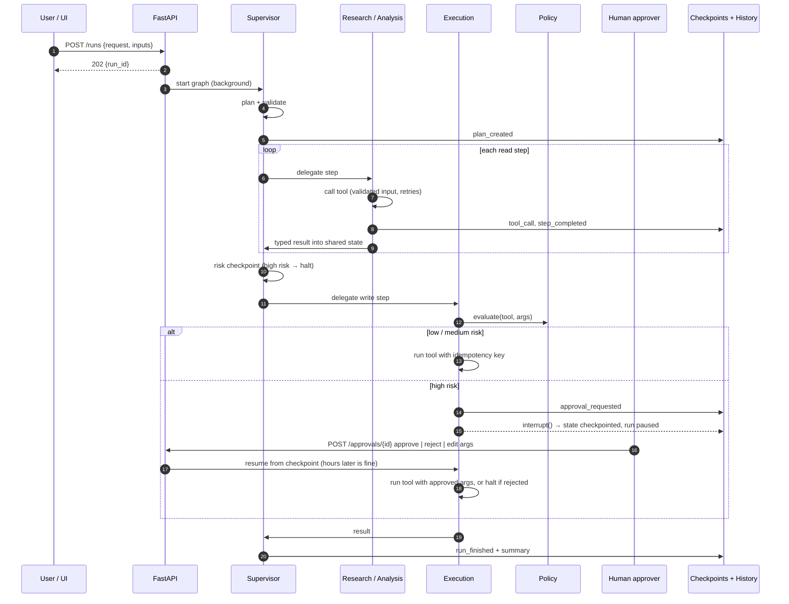

# Architecture

This page explains how AgentFlow works inside: the state model, the life of a request, the security model and what happens when things fail. For the reasoning behind each major choice, see the [architecture decision records](adr/).

## Components

| Component | File | Responsibility |
| --- | --- | --- |
| API | `app/api.py` | Accepts requests, returns immediately (202), serves status, history and the approval inbox |
| Runner | `app/runner.py` | Starts and resumes LangGraph runs; one lock per run; syncs status into history |
| Graph | `app/graph.py` | Supervisor, Research, Analysis, Execution, Approval and Finalize nodes |
| Planner | `app/agents/supervisor.py` | LLM plan (structured output) → validation → template fallback |
| Read agents | `app/agents/workers.py` | Research and Analysis; tool-calling loop over their own tools when Bedrock is on |
| Policy | `app/policy.py` | Rules that assign a risk tier and decide if a human must approve |
| Tools | `app/tools/` | One registry; each tool has an owner agent, a risk tier and a Pydantic input model |
| History | `app/history.py` | Append-only event log, approvals, idempotency keys |
| Checkpointer | LangGraph `SqliteSaver` | Full graph state after every node: pause, resume, survive restarts |

## State model

All agents share one typed state (`RunState`). Agents never message each other directly. They read from and write to this state, and the supervisor decides what runs next.

| Field | Meaning |
| --- | --- |
| `plan` | Validated list of steps: `{id, agent, action, args, description}` |
| `cursor` | Index of the next step |
| `facts` | Request inputs plus every tool output so far; `{{key}}` in step args reads from here |
| `results` | One entry per finished step: agent, tool, note, approver |
| `pending` | Approval waiting for a human: tool, args, tier, reason, evidence |
| `decision` | The human's answer, consumed once by the Execution node |
| `status` | `running` → `awaiting_approval` → `completed` / `halted` / `failed` |

## Life of a request (with approval)

## Security model

| Threat | Control |
| --- | --- |
| Prompt injection in web pages, documents or news | Untrusted text reaches only read-only agents; they have no write tools, so injected instructions can't change any system |
| LLM plans a dangerous or out-of-scope action | Plan validation: tool must exist, belong to the step's agent, and reads come before writes |
| Model "decides" an approval isn't needed | Approval is decided by `policy.py` rules on the actual arguments, never by the model |
| Agent calls a tool it doesn't own | Ownership checked in code at call time, not only in the prompt |
| Malformed or malicious arguments | Pydantic validation on every tool call (IBAN length, email format, positive amounts) |
| Double approval / race | `decide_approval` updates only rows still `pending`; second decision returns 409 |
| Duplicate writes after retry or crash | Idempotency key `run_id:step_id` per write; a replay returns the stored result |
| Approval never answered | TTL expiry turns it into a rejection and stops the run |
| Secrets in prompts | Credentials stay in environment / AgentCore Identity; agents only see tool results |

## Failure modes

| Failure | Behaviour |
| --- | --- |
| Transient API error (timeout, 5xx) | Retried with exponential backoff (3 attempts) |
| Invalid input or business rule violation | Fails fast, no retry; run ends `failed` with the reason in history |
| Missing value for a `{{key}}` | Step fails with the name of the missing input |
| LLM unavailable or returns an invalid plan | Falls back to a known workflow template; reason logged in `planner` |
| Runaway loop | `MAX_STEPS` limit; LangGraph recursion limit |
| Process restart while waiting for approval | State reloads from the checkpointer; the decision resumes the run |
| Request matches no workflow (offline mode) | Run ends `failed` with a clear message |

## Extending

- **New tool:** add a function and a Pydantic args model in `app/tools/*.py`, then `register(Tool(...))` with its owner agent and risk tier. The planner picks it up from the catalog automatically.
- **New workflow template:** add a factory to `app/agents/workflows.py`.
- **New approval rule:** add it to `policy.evaluate()` and cover it in `tests/test_policy_and_tools.py`.
- **Real system instead of a mock:** replace the call inside the tool function; agents and tests that use mocks stay the same.
